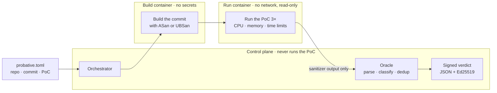

<p align="center">
  <picture>
    <source media="(prefers-color-scheme: dark)" srcset="docs/assets/logo-dark.svg">
    
  </picture>
</p>

<p align="center">
  <strong>Reproduce memory-safety vulnerability reports.<br>Get a signed verdict that anyone can re-run.</strong>
</p>

<p align="center">
  <a href="https://github.com/christianivanov/probative/actions/workflows/ci.yml"></a>
  <a href="LICENSE"></a>
  
  
</p>

---

Probative is a neutral, self-hosted verifier for the people who **receive** vulnerability reports: open-source maintainers and product security teams.

Give it a report about a memory-safety bug in a C or C++ project. Probative builds the affected commit with a sanitizer, runs the proof of concept in a locked-down sandbox, and lets the sanitizer decide whether the bug is real. No person and no language model makes that call. The result is a signed verdict you can attach to an issue, share with the reporter, or hand to anyone who wants to check it for themselves.

```console
$ probative verify --manifest probative.toml
reproduced  heap-buffer-overflow (WRITE) in parse_chunk  parser.c
            3/3 runs, same signature · claim: matches · severity hint: high
            fixed by 89abcde · verdict 0192c5e0-… signed by 3f9a1c2d4b5e6f70
```

> [!IMPORTANT]
> **Probative is in early design and is not usable yet.** This README describes where the project is going. Commands, file formats and outputs may still change. Star or watch the repository to follow along, and see [Roadmap](#roadmap) for progress.

## Why

Credible vulnerability reports are arriving faster than maintainers can reproduce them. Many are found with automated tools or AI assistance and look convincing. Reading them is cheap. The slow part is building the right version with the right flags, running an untrusted PoC safely, and working out what actually crashed and where. Today that is manual, repetitive work, and it takes hours per report.

Probative automates the reproduction and keeps the judgement objective:

- **Evidence, not opinion.** A report is `reproduced` only when a sanitizer reports a memory error in the project's own code in at least two of three runs.
- **Honest about doubt.** Crashes in dependencies, flaky results, timeouts and unsymbolized stacks are `inconclusive`, with a machine-readable reason.
- **Re-runnable by anyone.** Every verdict pins the commit, the build and run image digests, the PoC hash and the exact command to reproduce it.
- **Verifiable.** Verdicts are canonical JSON ([RFC 8785](https://www.rfc-editor.org/rfc/rfc8785)) signed with Ed25519, so they can be checked offline and cannot be quietly edited.

## How it works



1. **Describe the case.** A `probative.toml` manifest names the repository, the affected commit, the PoC and, optionally, what the report claims.
2. **Build.** Probative compiles the commit with AddressSanitizer or UndefinedBehaviorSanitizer using a trusted recipe: an [OSS-Fuzz](https://github.com/google/oss-fuzz) project, an [ARVO](https://github.com/n132/arvo) image for historical cases, or a manual recipe, either reviewed in this repository or written by you for your own project. Builds are cached by the hash of their inputs.
3. **Run.** The PoC runs three times in a container with no network, no secrets, no capabilities and a read-only filesystem, as an unprivileged user with strict resource limits.
4. **Decide.** A deterministic oracle parses the sanitizer output, separates project frames from runtime and dependency frames, computes a stable deduplication signature and applies a fixed decision table.
5. **Sign.** The verdict is canonicalized and signed. If a fix commit is given, Probative also checks that the fix makes the crash go away.

## A case in one file

The manifest is the input to Probative and is designed as an open, tool-independent description of a **reproducible vulnerability report**. Anyone can write one by hand, and a [JSON Schema](docs/manifest.schema.json) with [examples](docs/examples/) describes every field.

```toml
schema_version = "0.1"

[target]
repo_url   = "https://github.com/example/libexample"
commit     = "0123456789abcdef0123456789abcdef01234567"
fix_commit = "89abcdef0123456789abcdef0123456789abcdef"  # optional

[build]
recipe           = "oss_fuzz"     # "oss_fuzz", "arvo" or "manual"
sanitizer        = "address"      # "address" or "undefined"
oss_fuzz_project = "libexample"

[poc]
type        = "fuzz_input"        # "fuzz_input", "cli" or "harness"
file        = "poc/crash-1a2b3c"
fuzz_target = "parse_fuzzer"

[claim]                           # what the report says; all optional
kind     = "heap-buffer-overflow"
access   = "write"
function = "parse_chunk"
file     = "parser.c"
```

## Verdicts

Every `verify` run produces a signed JSON verdict with the outcome, the evidence and everything needed to reproduce it. Its format is defined by a [JSON Schema](docs/verdict.schema.json).

<details>
<summary>Excerpt of the signed verdict (illustrative)</summary>

```json
{
  "schema_version": "0.1",
  "outcome": "reproduced",
  "target": {
    "repo_url": "https://github.com/example/libexample",
    "commit": "0123456789abcdef0123456789abcdef01234567"
  },
  "finding": {
    "sanitizer": "address",
    "kind": "heap-buffer-overflow",
    "access": "write",
    "top_project_frames": ["parse_chunk", "parse_document", "load_file"]
  },
  "claim_match": "matches",
  "severity_hint": { "value": "high", "source": "heuristic" },
  "fix": { "commit": "89abcdef0123456789abcdef0123456789abcdef", "fixed_by_commit": true },
  "dedup_signature": "9c1e…",
  "repro": { "command": "probative verify --manifest probative.toml" },
  "signature": { "alg": "ed25519", "key_id": "3f9a1c2d4b5e6f70", "value": "…" }
}
```

</details>

Anyone can check a verdict, and optionally reproduce it from scratch:

```console
$ probative check verdict.json --rerun --manifest probative.toml
```

| Exit code | Meaning |
| :-: | --- |
| `0` | `reproduced` (for `check`: valid signature from a trusted key) |
| `10` | `not_reproduced` |
| `20` | `inconclusive` |
| `3` | refused by policy (repository not allowed, PoC too large) |

## Design principles

- **Untrusted in, evidence out.** Reports and PoCs are always treated as hostile. The only thing that leaves the sandbox is the sanitizer output.
- **No LLM in the verdict path.** `verify` never calls a language model. An optional, off-by-default helper can draft a manifest from a free-text report, but a human reviews it, and the type system makes it impossible for anything but the oracle to produce a decision.
- **When in doubt, `inconclusive`.** A false `reproduced` is the worst possible outcome, and the decision table is built to avoid it.
- **Self-hosted and neutral.** Probative works with reports from any channel and runs on your own infrastructure. Embargoed reports never need to leave your machine.
- **Defensive only.** Probative runs the PoC that comes with a report. It never generates or extends exploits.

## Scope

| Supported (planned for the first release) | Not yet |
| --- | --- |
| C and C++ projects that build with clang | Other languages |
| AddressSanitizer and UndefinedBehaviorSanitizer findings | Logic bugs, web applications |
| PoCs as fuzzer inputs, CLI invocations or C/C++ harnesses | PoCs that need a network peer (for example, a malicious server) |
| Linux x86_64 containers (Docker, Docker rootless, Colima) | arm64 hosts, microVM isolation |

## Roadmap

- [ ] **Design:** [threat model](docs/THREAT_MODEL.md), [architecture decision records](docs/adr/), [manifest](docs/manifest.schema.json) and [verdict](docs/verdict.schema.json) schemas, evaluation plan
- [ ] **Reproduce:** hardened Docker sandbox, a first end-to-end reproduction with ARVO images, then sanitizer builds from OSS-Fuzz, manual and operator-local recipes
- [ ] **Verdict:** sanitizer parser, deterministic oracle, deduplication, Ed25519 signing, `check`, public evaluation, Markdown summaries for issues and advisories, and `probative init` to start a manifest
- [ ] **Assist:** optional LLM-assisted manifest drafting and an [MCP](https://modelcontextprotocol.io) server
- [ ] **Harden:** Firecracker microVM backend, GitHub Security Advisories integration

The evaluation set is built from real, publicly reproducible vulnerabilities. Its success criterion is zero false `reproduced` verdicts.

## Contributing

Probative is at the stage where design feedback matters most. If you maintain a C or C++ project and triage security reports, we would love to hear how you do it today. Please open an issue.

We are not accepting code contributions yet; see [CONTRIBUTING.md](CONTRIBUTING.md) for how that will work.

## Security

Probative is designed around the assumption that every report and PoC is hostile. The [threat model](docs/THREAT_MODEL.md) lists the threats, the controls against each one and the questions still open.

To report a vulnerability **in Probative itself**, see [SECURITY.md](SECURITY.md). Probative is not a reporting channel for vulnerabilities in other projects.

## Acknowledgements

Probative stands on the shoulders of the [LLVM sanitizers](https://clang.llvm.org/docs/AddressSanitizer.html), [libFuzzer](https://llvm.org/docs/LibFuzzer.html), [OSS-Fuzz](https://github.com/google/oss-fuzz) and the [ARVO](https://github.com/n132/arvo) dataset of reproducible vulnerabilities.

## Name

In law, *probative value* is how much a piece of evidence actually proves. Every verdict Probative produces is meant to carry exactly that.

## License

Probative is free software, licensed under the [GNU Affero General Public License v3.0 only](LICENSE) (`AGPL-3.0-only`).
