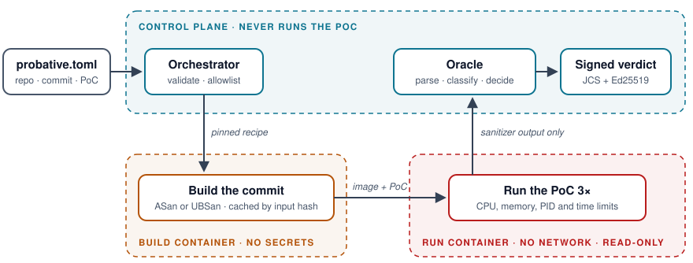

<p align="center">
  <picture>
    <source media="(prefers-color-scheme: dark)" srcset="docs/assets/logo-dark.svg">
    
  </picture>
</p>

<h3 align="center">Reproduce memory-safety vulnerability reports.<br>Get a signed verdict that anyone can re-run.</h3>

<p align="center">
  <a href="https://github.com/christianivanov/probative/actions/workflows/ci.yml"></a>
  <a href="LICENSE"></a>
  
  
</p>

<p align="center">
  <a href="#why-probative">Why</a> ·
  <a href="#how-it-works">How it works</a> ·
  <a href="#a-case-in-one-file">Manifest</a> ·
  <a href="#verdicts">Verdicts</a> ·
  <a href="#roadmap">Roadmap</a> ·
  <a href="#faq">FAQ</a>
</p>

<br>

<p align="center">
  
</p>

> [!IMPORTANT]
> **Probative is in early design and does not run yet.** The output above is illustrative, and commands, file formats and outputs may change. Watch the repository to follow along, and see the [roadmap](#roadmap) for progress.

**Probative is a self-hosted verifier for the people who receive vulnerability reports:** open-source maintainers and product security teams.

Give it a report about a memory-safety bug in a C or C++ project. Probative builds the affected commit with a sanitizer, runs the proof of concept in a locked-down sandbox, and lets the sanitizer decide whether the bug is real. **No person and no language model makes that call.** You get a signed verdict to attach to an issue, send back to the reporter, or hand to anyone who wants to check it for themselves.

## Why Probative

Credible vulnerability reports are arriving faster than maintainers can reproduce them. Many are found with automated tools or AI assistance, and they look convincing. Reading a report takes minutes. Reproducing it can take hours: building the right version with the right flags, running an untrusted PoC safely, and working out what actually crashed and where.

|  | By hand | With Probative |
| --- | --- | --- |
| **Build** | Find the commit, the flags and the dependencies that make it compile | A pinned recipe builds it with ASan or UBSan, cached by input hash |
| **Run** | Run a stranger's PoC on your workstation | Three runs in a container with no network, no secrets and a read-only filesystem |
| **Decide** | Read stack traces and make a judgement call | A deterministic oracle applies a fixed, published decision table |
| **Share** | Paste logs into a thread and hope they're enough | A signed verdict that anyone can check offline and re-run from scratch |

<table>
<tr>
<td width="50%" valign="top">

### 🔬 Evidence, not opinion

A report is `reproduced` only when a sanitizer reports the same memory error in the project's own code in at least two of three runs.

</td>
<td width="50%" valign="top">

### ⚖️ Honest about doubt

Crashes in dependencies, flaky results, timeouts and unsymbolized stacks are `inconclusive`, with a machine-readable reason. A false `reproduced` is the one result Probative is built never to give.

</td>
</tr>
<tr>
<td width="50%" valign="top">

### 🔁 Re-runnable by anyone

Every verdict pins the commit, the build and run image digests, the PoC hash and the exact command that reproduces it.

</td>
<td width="50%" valign="top">

### ✍️ Verifiable by third parties

Verdicts are canonical JSON ([RFC 8785](https://www.rfc-editor.org/rfc/rfc8785)) signed with Ed25519. Anyone can check them offline, with independent tools, without trusting whoever produced them.

</td>
</tr>
</table>

## How it works

<p align="center">
  <picture>
    <source media="(prefers-color-scheme: dark)" srcset="docs/assets/how-it-works-dark.svg">
    
  </picture>
</p>

1. **Describe the case.** A `probative.toml` manifest names the repository, the affected commit, the PoC and, optionally, what the report claims.
2. **Build.** Probative compiles the commit with AddressSanitizer or UndefinedBehaviorSanitizer using a trusted recipe: an [OSS-Fuzz](https://github.com/google/oss-fuzz) project, an [ARVO](https://github.com/n132/arvo) image for historical cases, or a manual recipe, either reviewed in this repository or written by you for your own project. Recipes never come from the report.
3. **Run.** The PoC runs three times as an unprivileged user, with no network, no secrets, no capabilities, a read-only filesystem and strict CPU, memory, process and time limits.
4. **Decide.** A deterministic oracle parses the sanitizer output, separates the project's frames from runtime and dependency frames, computes a stable deduplication signature and applies a fixed decision table.
5. **Sign.** The verdict is canonicalized and signed. If you give a fix commit, Probative also checks that the fix makes the crash go away.

### Three possible outcomes

| Outcome | When | Exit code |
| --- | --- | :-: |
|  | The same sanitizer finding, with frames in the project's own code, in at least 2 of 3 runs | `0` |
|  | Three clean runs | `10` |
|  | Anything else, with a reason: `build_failed`, `crash_in_dependency`, `unsymbolized`, `flaky`, `timeout`, `resource_limit` or `no_sanitizer_report` | `20` |

Exit code `3` means the case was refused by policy (for example, a repository that is not on the allow list, or a PoC that is too large).

## A case in one file

The manifest is the input to Probative and an open, tool-independent description of a **reproducible vulnerability report**. Anyone can write one by hand: a [JSON Schema](docs/manifest.schema.json) and [examples](docs/examples/) describe every field.

```toml
schema_version = "0.1"

[target]
repo_url   = "https://github.com/example/libexample"
commit     = "0123456789abcdef0123456789abcdef01234567"
fix_commit = "89abcdef0123456789abcdef0123456789abcdef"  # optional

[build]
recipe           = "oss_fuzz"     # "oss_fuzz", "arvo" or "manual"
sanitizer        = "address"      # "address" or "undefined"
oss_fuzz_project = "libexample"

[poc]
type        = "fuzz_input"        # "fuzz_input", "cli", "harness" or "network"
file        = "poc/crash-1a2b3c"
fuzz_target = "parse_fuzzer"

[claim]                           # what the report says; all optional
kind     = "heap-buffer-overflow"
access   = "write"
function = "parse_chunk"
file     = "parser.c"
```

| PoC type | What it is | Example |
| --- | --- | --- |
| `fuzz_input` | An input for a fuzz target | A crash file for an OSS-Fuzz fuzzer |
| `cli` | An invocation of a project binary | `xmllint --noout {poc}` |
| `harness` | A C or C++ program that links the library | `poc.c` |
| `network` | A server or client that talks to a project binary over loopback, inside the sandbox | A server that sends a malformed response to `curl` |

## Verdicts

Every `verify` run produces a signed JSON verdict with the outcome, the evidence and everything needed to reproduce it. Its format is defined by a [JSON Schema](docs/verdict.schema.json) and is the project's central contract: it does not change without an [architecture decision record](docs/adr/).

<details>
<summary><b>Excerpt of a signed verdict</b> (illustrative)</summary>

```json
{
  "schema_version": "0.1",
  "outcome": "reproduced",
  "target": {
    "repo_url": "https://github.com/example/libexample",
    "commit": "0123456789abcdef0123456789abcdef01234567"
  },
  "finding": {
    "sanitizer": "address",
    "kind": "heap-buffer-overflow",
    "access": "write",
    "top_project_frames": ["parse_chunk", "parse_document", "load_file"]
  },
  "claim_match": "matches",
  "severity_hint": { "value": "high", "source": "heuristic" },
  "fix": { "commit": "89abcdef0123456789abcdef0123456789abcdef", "fixed_by_commit": true },
  "dedup_signature": "9c1e…",
  "repro": { "command": "probative verify --manifest probative.toml" },
  "signature": { "alg": "ed25519", "key_id": "3f9a1c2d4b5e6f70", "value": "…" }
}
```

</details>

<details>
<summary><b>Summary ready to paste into an issue or advisory</b> (planned, illustrative)</summary>

<br>

> **Probative verdict: reproduced**
>
> | | |
> | --- | --- |
> | Finding | `heap-buffer-overflow` (write) in `parse_chunk`, `parser.c` |
> | Runs | 3 of 3, same signature |
> | Report claim | matches |
> | Fix `89abcde` | removes the crash |
> | Severity hint | high (heuristic) |
> | Verdict | `0192c5e0-…`, signed by key `3f9a1c2d4b5e6f70` |
>
> Re-run with `probative verify --manifest probative.toml`. Confidential until disclosure.

</details>

Anyone can check a verdict, and optionally reproduce it from scratch:

```console
$ probative check verdict.json --rerun --manifest probative.toml
```

## Design principles

- **Untrusted in, evidence out.** Reports and PoCs are always treated as hostile. The only thing that leaves the sandbox is the sanitizer output.
- **No LLM in the verdict path.** `verify` never calls a language model. An optional, off-by-default helper can draft a manifest from a free-text report, a human reviews it, and the type system makes it impossible for anything but the oracle to produce a decision.
- **When in doubt, `inconclusive`.** A false `reproduced` is the worst possible outcome, and the decision table is built to avoid it.
- **Self-hosted and neutral.** Probative works with reports from any channel and runs on your own infrastructure. Embargoed reports never need to leave your machine.
- **Defensive only.** Probative runs the PoC that comes with a report. It never generates or extends exploits.

## Scope

| Planned for the first release | Not yet |
| --- | --- |
| C and C++ projects that build with clang | Other languages (designed for it; Rust is the first candidate) |
| AddressSanitizer and UndefinedBehaviorSanitizer findings | Logic bugs, web applications |
| Fuzzer inputs, CLI invocations, C/C++ harnesses and loopback network PoCs | PoCs that need the internet or external services |
| Linux x86_64 containers (Docker, Docker rootless, Colima) | arm64 hosts |
| A single binary for Linux and macOS, with signed releases | |

## Roadmap

| | Phase | What it delivers |
| :-: | --- | --- |
| 🚧 | **Design** | [Threat model](docs/THREAT_MODEL.md), [architecture decision records](docs/adr/), [manifest](docs/manifest.schema.json) and [verdict](docs/verdict.schema.json) schemas, core types, evaluation plan |
| ⬜ | **Reproduce** | Hardened Docker sandbox; a first end-to-end reproduction with ARVO images; sanitizer builds from OSS-Fuzz, manual and operator-local recipes |
| ⬜ | **Verdict** | Sanitizer parser, deterministic oracle, deduplication, Ed25519 signing and `check`; harness and network PoCs; a guide to verifying verdicts without trusting their producer; a public benchmark; Markdown summaries; `probative init`; signed releases (static Linux binary, macOS, Homebrew) and a GitHub Action |
| ⬜ | **Assist** | Optional LLM-assisted manifest drafting and an [MCP](https://modelcontextprotocol.io) server |
| ⬜ | **Harden** | A Firecracker microVM backend, required before running untrusted third-party PoCs anywhere other than the operator's own machine; GitHub Security Advisories integration |
| ⬜ | **Beyond C and C++** | New ecosystems through the same oracle interface ([ADR-008](docs/adr/008-extensibility.md)), starting with Rust, only after the benchmark is public |

### Benchmark

The evaluation set is built from real, publicly reproducible vulnerabilities: hundreds of historical cases from [ARVO](https://github.com/n132/arvo) and real reports against curl. The results will be published with confidence intervals, the number of false `reproduced` verdicts and the coverage by PoC type, and anyone will be able to reproduce them with one command. **The success criterion is zero false `reproduced` verdicts.** See [docs/BENCHMARK.md](docs/BENCHMARK.md) for the method.

## FAQ

<details>
<summary><b>Is this an AI triage tool?</b></summary>

<br>

No. The verdict comes from a sanitizer and a deterministic decision table, and `verify` never calls a language model. A later, optional helper can draft a manifest from a free-text report. It is off by default, a human reviews what it drafts, and nothing it produces can become a decision.

</details>

<details>
<summary><b>Is it safe to run untrusted PoCs on my machine?</b></summary>

<br>

PoCs only run inside a container with no network, no secrets, no capabilities, a read-only filesystem, an unprivileged user and strict limits, and Probative never mounts the Docker socket or uses privileged mode. Containers share the host kernel, so a microVM backend is planned before Probative runs untrusted third-party PoCs anywhere other than the operator's own machine. The [threat model](docs/THREAT_MODEL.md) lists every threat, the controls against it and what remains open.

</details>

<details>
<summary><b>Does my report leave my machine?</b></summary>

<br>

Not with `verify`. Probative is self-hosted: builds fetch source code and images, but report text and PoC bytes stay on your infrastructure and are never logged above debug level. The only component that could send a report anywhere is the optional drafting helper, which is off by default and talks only to an endpoint you configure.

</details>

<details>
<summary><b>What does a verdict not prove?</b></summary>

<br>

A `reproduced` verdict proves that the PoC triggers a specific sanitizer finding in the project's code at a given commit. It does not prove exploitability, and its severity is only a heuristic hint. A `not_reproduced` verdict means the PoC did not trigger a finding under these conditions, not that the bug does not exist.

</details>

<details>
<summary><b>Why three runs?</b></summary>

<br>

One crash can be noise. Requiring the same deduplication signature in at least two of three runs separates real, deterministic memory errors from flaky behaviour, and anything in between is reported as `inconclusive` with the reason `flaky`.

</details>

## Contributing

Probative is at the stage where design feedback matters most. If you maintain a C or C++ project and triage security reports, we would love to hear how you do it today: please [open an issue](https://github.com/christianivanov/probative/issues).

We are not accepting code contributions yet. See [CONTRIBUTING.md](CONTRIBUTING.md) for how that will work.

## Security

Probative is designed on the assumption that every report and every PoC is hostile. The [threat model](docs/THREAT_MODEL.md) lists the threats, the controls against each one and the questions still open.

To report a vulnerability **in Probative itself**, see [SECURITY.md](SECURITY.md). Probative is not a reporting channel for vulnerabilities in other projects.

## Acknowledgements

Probative stands on the shoulders of the [LLVM sanitizers](https://clang.llvm.org/docs/AddressSanitizer.html), [libFuzzer](https://llvm.org/docs/LibFuzzer.html), [OSS-Fuzz](https://github.com/google/oss-fuzz) and the [ARVO](https://github.com/n132/arvo) dataset of reproducible vulnerabilities.

## Why "Probative"?

In law, *probative value* is how much a piece of evidence actually proves. Every verdict Probative produces is meant to carry exactly that.

## License

Probative is free software, licensed under the [GNU Affero General Public License v3.0 only](LICENSE) (`AGPL-3.0-only`).
