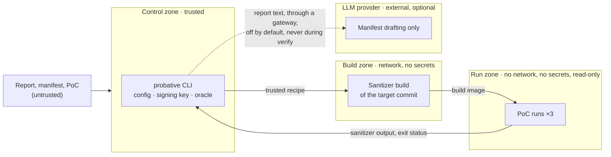

# Threat model

Probative exists to run code that strangers send in. This document lists what we protect, who we protect it from, how each threat is mitigated, and which risks remain open.

**Status:** design phase. The controls below describe the intended design; none is implemented yet. Each control says where it will be enforced and how it will be tested, and this document is updated in the same change as any modification to the sandbox, a build recipe, the oracle or the verdict format.

**Contents:** [System overview](#system-overview) · [Assets](#assets) · [Adversaries](#adversaries) · [Threats](#threats) · [Controls](#controls) · [Open questions](#open-questions) · [Out of scope](#out-of-scope)

## System overview

Probative is split into four trust zones. Untrusted input crosses into the build and run zones as data only, and the only thing that comes back from the run zone is the sanitizer output.

| Zone | Runs | Holds | Network |
| --- | --- | --- | --- |
| **Control** | The `probative` process. Never runs the PoC or build scripts. | Configuration, signing key, verdict store, reports and PoCs at rest | Only to reach Docker and, if enabled, the LLM gateway |
| **Build** | Recipe steps and the project's build scripts, in a container | Source code and build outputs. No secrets, no Docker socket | Yes, to fetch source code and dependencies |
| **Run** | The project's instrumented binary with the PoC as input, in a container | The build image plus the PoC. No secrets | None |
| **LLM provider** | Manifest drafting from report text (`probative extract`) | Whatever it is sent | External; reached only through a gateway that holds the credentials |

## Assets

| ID | Asset | Why it matters |
| --- | --- | --- |
| A1 | **The host** running Probative and its network | Compromise gives an attacker a foothold in the maintainer's or security team's infrastructure. |
| A2 | **The signing key** | Whoever holds it can issue verdicts that verify as genuine. |
| A3 | **Verdict integrity** | A false `reproduced` wastes maintainer time and damages trust in every other verdict. A false `not_reproduced` can bury a real vulnerability. |
| A4 | **Confidentiality of reports, PoCs and verdicts** | Reports are usually under embargo. A leak can expose users before a fix is available. |
| A5 | **LLM provider credentials** | Probative never holds them. They live in the gateway configured as `[llm] endpoint`. |

## Adversaries

- **Malicious reporter.** Controls the report text, the PoC and every field of the manifest. May point the manifest at a commit they authored. This is the main adversary.
- **Malicious or compromised upstream.** Build scripts, dependencies or third-party images (OSS-Fuzz base images, ARVO images) that behave maliciously during a build or a run.
- **Verdict forger.** Anyone who handles a verdict after it is issued and wants it to say something else.
- **Prompt injector.** A reporter who writes instructions into the report hoping an LLM follows them.
- **Local attacker.** Someone with an unprivileged account on the host, or access to the Docker daemon.

## Threats

Each threat links to the [controls](#controls) that mitigate it. Threats with a gap that still needs a design decision also link to an [open question](#open-questions).

| ID | Threat | Vector | Assets | Mitigated by |
| --- | --- | --- | --- | --- |
| T1 | **Sandbox escape** | A PoC that exploits the kernel or the container runtime | A1, A2, A4 | [C1](#c1-no-network-in-the-run-zone), [C2](#c2-least-privilege-containers), [C3](#c3-read-only-run-filesystem), [C4](#c4-resource-limits-for-runs), [C17](#c17-hardened-deployment) |
| T2 | **Malicious build scripts** | A repository, commit or dependency controlled by the reporter | A1, A4 | [C6](#c6-repository-allowlist-and-pinned-commits), [C7](#c7-isolated-build-zone), [C8](#c8-recipes-are-trusted-configuration); see [Q2](#q2-commits-that-only-exist-in-a-fork) and [Q3](#q3-network-access-during-builds) |
| T3 | **Exfiltration from the PoC** | The PoC opens network connections or writes data somewhere it can be collected | A4, A1 | [C1](#c1-no-network-in-the-run-zone), [C3](#c3-read-only-run-filesystem), [C5](#c5-clean-execution-environment), [C7](#c7-isolated-build-zone) |
| T4 | **Prompt injection** | Instructions hidden in the report text | A3, A4 | [C15](#c15-llm-outside-the-verdict-path), [C11](#c11-deterministic-oracle-and-unforgeable-decisions) |
| T5 | **Verdict forgery** | Editing a verdict JSON, or presenting it as signed by someone else | A3 | [C12](#c12-signed-canonical-verdicts), [C13](#c13-signing-key-protection) |
| T6 | **Build cache poisoning** | A tampered build image reused for a later case | A3 | [C9](#c9-content-addressed-build-cache), [C8](#c8-recipes-are-trusted-configuration) |
| T7 | **Path traversal** | `..`, absolute paths or symlinks in `poc.file` or in MCP tool arguments, or swapping the file after validation | A1, A4 | [C10](#c10-strict-manifest-and-poc-validation), [C16](#c16-confined-mcp-server) |
| T8 | **Host resource exhaustion** | Huge PoCs, endless output, fork bombs, memory bombs or never-ending builds | A1 | [C4](#c4-resource-limits-for-runs), [C7](#c7-isolated-build-zone), [C10](#c10-strict-manifest-and-poc-validation) |
| T9 | **Leak of embargoed material** | Logs, the LLM provider, files on disk or shared verdicts | A4 | [C14](#c14-confidentiality-of-reports-pocs-and-verdicts), [C5](#c5-clean-execution-environment), [C15](#c15-llm-outside-the-verdict-path) |
| T10 | **Signing key theft** | Local access to the host, or a container that can read the key | A2 | [C13](#c13-signing-key-protection), [C2](#c2-least-privilege-containers) |
| T11 | **Docker daemon takeover** | The Docker socket reachable from a container, or a privileged container | A1 | [C2](#c2-least-privilege-containers), [C7](#c7-isolated-build-zone), [C17](#c17-hardened-deployment) |
| T12 | **Oracle spoofing** | The PoC makes the target print text that looks like a sanitizer report (for example, an input echoed in an error message), a harness prints a fake report, or a tampered image fakes one | A3 | [C11](#c11-deterministic-oracle-and-unforgeable-decisions), [C8](#c8-recipes-are-trusted-configuration); see [Q1](#q1-fake-sanitizer-reports) |
| T13 | **Unreviewed code in an allowlisted repository** | A commit pushed to a fork, which hosts like GitHub serve from the upstream repository URL | A1, A3 | [C6](#c6-repository-allowlist-and-pinned-commits), [C7](#c7-isolated-build-zone); see [Q2](#q2-commits-that-only-exist-in-a-fork) |
| T14 | **Network abuse from the build zone** | Build scripts that scan the local network or query cloud metadata endpoints | A1, A5 | [C7](#c7-isolated-build-zone), [C17](#c17-hardened-deployment); see [Q3](#q3-network-access-during-builds) |
| T15 | **Supply chain of Probative itself** | A compromised dependency or CI action | A1, A2, A3 | [C18](#c18-supply-chain-of-probative) |

## Controls

Each control names where it will be enforced and how it will be tested.

### C1: No network in the run zone

- The run container uses `network_mode = none`. The derived image that adds the PoC is also built with networking disabled.
- The build container never runs the PoC, so the PoC never shares a container with network access.
- **Enforced in:** `probative-sandbox`. **Tested by:** a containment test in which a PoC tries to connect to `1.1.1.1:443` and must fail without any traffic leaving the host.

### C2: Least-privilege containers

- Run containers drop all capabilities (`cap_drop = ALL`), set `no-new-privileges`, keep Docker's default seccomp profile (never `unconfined`) and run as `65534:65534` (nobody).
- No container, build or run, is ever `privileged`, gets devices, bind mounts, published ports or the Docker socket.
- **Enforced in:** `probative-sandbox`. These settings are constants, not configuration. **Tested by:** unit tests on the generated container configuration and containment tests.

### C3: Read-only run filesystem

- The root filesystem is read-only. The only writable path is a `tmpfs` at `/tmp` mounted `rw,nosuid,nodev,size=64m`.
- The PoC is baked into a derived image at `/poc` with mode `0444`. Nothing is copied into a running container.
- **Enforced in:** `probative-sandbox`. **Tested by:** a containment test that writes to `/` and must fail.

### C4: Resource limits for runs

- Memory is capped with swap disabled (`memory = memory_swap`), CPU is limited to one core, processes to 256, and `ulimits` set `core = 0` and `nofile = 1024`.
- Every run has a wall-clock timeout. When it expires the container is killed with `SIGKILL` and the run is marked `timed_out`.
- Only the last `output_bytes` of stderr are kept (the sanitizer report is at the end) and stdout is only counted. Container logging is disabled, so output never accumulates on the host disk.
- Limit violations lead to `inconclusive` (`timeout` or `resource_limit`), never to a tool crash.
- **Enforced in:** `probative-sandbox`. **Tested by:** containment tests with a fork bomb, an infinite loop, 10 GB of stderr and a 16 GB allocation.

### C5: Clean execution environment

- The command is an argv in exec form, never a shell.
- The environment contains only `ASAN_OPTIONS`, `UBSAN_OPTIONS` and `ASAN_SYMBOLIZER_PATH`. Nothing is inherited from the host.
- Containers are removed after each run.
- **Enforced in:** `probative-sandbox`. **Tested by:** unit tests on the generated container configuration.

### C6: Repository allowlist and pinned commits

- Probative only builds repositories listed in the local configuration. URLs must be `https` and are normalized before comparison. A repository outside the list is a policy error (exit code 3), never a build.
- Commits must be full 40-character SHA-1 hashes. Short hashes, branches and tags are rejected, so the code built cannot change under the same manifest.
- **Enforced in:** `probative-core`. **Tested by:** one unit test per validation rule.

### C7: Isolated build zone

- Build scripts only run inside the build container. It has network access to fetch sources, but no secrets, no Docker socket, no host mounts and no access to the signing key.
- Builds have their own limits (45 minutes, 8 GB of memory, 4 CPUs and 4096 processes by default). Exceeding them leads to `inconclusive` (`build_failed`).
- The build container never runs the PoC.
- **Enforced in:** `probative-build` and `probative-sandbox`. **Tested by:** unit tests on the build container configuration and a build-timeout test.

### C8: Recipes are trusted configuration

- Build recipes come only from Probative's own reviewed `recipes/` directory, from a pinned OSS-Fuzz commit or from ARVO images pinned by digest. A report can never supply or modify a recipe.
- OSS-Fuzz projects are built without `infra/helper.py`, which runs privileged containers.
- Base images are referenced by digest, and Probative adds the sanitizer flags itself.
- **Enforced in:** `probative-build`. **Tested by:** unit tests that reject unknown recipes and images without a digest.

### C9: Content-addressed build cache

- Build images are tagged with a hash of every build input: recipe, repository, commit, sanitizer, base image digest, OSS-Fuzz commit or ARVO id, and Probative version. A different input can never reuse a cached image.
- Every verdict records the build and run image digests, so a reviewer can tell exactly what ran. `probative cache prune` removes old images.
- **Enforced in:** `probative-build`. **Tested by:** unit tests showing that changing any input changes the cache key.

### C10: Strict manifest and PoC validation

- Unknown manifest keys are rejected (except under `[extensions]`, which `verify` ignores). Fields that do not apply to the chosen recipe or PoC type are forbidden.
- `poc.file` must be relative, contain no `..` or absolute components, and stay inside the manifest directory after resolving symlinks.
- The PoC is read once, hashed and size-checked (10 MiB by default). The same bytes are used for the run image, so swapping the file after validation has no effect. If the manifest declares a `sha256`, it must match.
- `argv` is limited to 64 elements of at most 4096 bytes each, with no NUL bytes. `binary` must be a name declared by the recipe, never a path.
- **Enforced in:** `probative-core`. **Tested by:** one unit test per rule, including symlink and `..` traversal.

### C11: Deterministic oracle and unforgeable decisions

- Only deterministic code interprets sanitizer output. `reproduced` requires the same signature in at least two of three runs, with at least one frame in the project's own code. Anything less certain is `inconclusive` with a reason.
- A `Decision` can only be created by the oracle: its fields are private and it does not implement `Deserialize`. The verdict builder only accepts a `Decision`, so no other code, and no LLM output, can produce a verdict.
- **Enforced in:** `probative-oracle` and `probative-verdict`. **Tested by:** a `compile_fail` doctest that tries to build a `Decision` outside the oracle, one test per row of the decision table, and an evaluation set whose acceptance criterion is zero false `reproduced` verdicts.

### C12: Signed canonical verdicts

- Verdicts are serialized as canonical JSON (RFC 8785) and signed with Ed25519. The signature covers every field except the signature itself.
- `probative check` verifies the signature and reports whether the key is in the local trust list. `check --rerun` reproduces the case from its manifest and compares the outcome and dedup signature.
- **Enforced in:** `probative-verdict`. **Tested by:** round-trip tests, tests where any edited field invalidates the signature, and a verdict produced on one machine and verified on another.

### C13: Signing key protection

- The private key is stored at `<config>/keys/ed25519.key` with mode `0600` and never enters a container, a log line or a verdict.
- `probative keys init` refuses to overwrite an existing key without `--force`, which is also how keys are rotated. Trusted public keys are listed explicitly in the configuration.
- **Enforced in:** `probative-verdict` and `probative-cli`. **Tested by:** unit tests on file permissions and overwrite protection.

### C14: Confidentiality of reports, PoCs and verdicts

- Report text and PoC bytes are never logged above the `debug` level.
- The verdict store is created with mode `0700` and key files with mode `0600`.
- Verdicts describe the bug (type, functions, files), so they are as sensitive as the report until the issue is disclosed. Documentation will say so wherever verdicts are shared.
- **Enforced in:** every crate, through review and the logging conventions. **Tested by:** unit tests on store permissions.

### C15: LLM outside the verdict path

- `probative verify` never calls a language model. The optional `probative extract` command only writes a draft manifest that a human reviews before running `verify`.
- The LLM integration is disabled by default. Enabling it is an explicit choice, and the CLI warns that the report leaves the machine unless the endpoint is local. Calls go through a gateway that holds the provider credentials, so Probative never stores them.
- The prompt is fixed in code and the report is passed as delimited data. The answer must be JSON matching a schema, with length limits. Invalid fields, and repositories outside the allowlist, are left empty in the draft for a human to fill in. The LLM never supplies PoC bytes.
- **Enforced in:** `probative-extract`. **Tested by:** an evaluation group of reports containing injected instructions, which must not add fields or change any outcome.

### C16: Confined MCP server

- The MCP server only accepts paths inside a configured workspace, checked after resolving symlinks.
- No tool exposes a shell, Docker or the signing key.
- **Enforced in:** `probative-mcp`. **Tested by:** unit tests with paths outside the workspace and with symlinks.

### C17: Hardened deployment

- Linux hosts should run Docker in rootless mode, so a container escape lands in an unprivileged account. On macOS, Docker Desktop and Colima already run containers inside a virtual machine.
- Probative refuses to run on non-x86_64 hosts instead of emulating them.
- Membership in the `docker` group is equivalent to root. Hosts running Probative should be dedicated to it, or at least keep that group restricted.
- A microVM backend (Firecracker) is planned so that each run gets its own kernel.
- **Enforced in:** documentation and `probative doctor`. **Tested by:** `probative doctor` checks.

### C18: Supply chain of Probative

- Dependencies are checked by `cargo-deny` on every change (security advisories, allowed licenses, crates.io as the only source) and builds use the committed `Cargo.lock`.
- CI actions are pinned by commit SHA and run with a read-only token.
- **Enforced in:** CI. **Tested by:** CI itself.

## Open questions

These gaps need a design decision before the related phase is implemented. Until then, the mitigations listed are only partial.

### Q1: Fake sanitizer reports

The oracle reads sanitizer reports from the process's stderr. Text that looks like a report can reach stderr without any memory error:

- a CLI binary that echoes part of its input in an error message, with a PoC that contains a fake report;
- a `harness` PoC, which is reporter-written code running inside the process and can print anything;
- a tampered third-party image.

This threatens the central guarantee of zero false `reproduced` verdicts. Candidate mitigations, which can be combined:

1. Have the sanitizer runtime write reports to a dedicated location (for example, ASan's `log_path`) instead of reading stderr.
2. Require the exit status to be consistent with a sanitizer abort, and exactly one report per run.
3. Re-symbolize the program counters in the report against the trusted build image and require them to match the frames reported.
4. Treat `harness` PoCs as lower assurance, for example by requiring the faulting frame to be in project code and recording the PoC type prominently in the verdict.

### Q2: Commits that only exist in a fork

On GitHub, a commit pushed to any fork can be fetched by its SHA through the upstream repository URL. The allowlist therefore does not guarantee that the code built was reviewed upstream. Option: require the commit to be reachable from a branch or tag of the upstream repository, at the cost of rejecting reports against unmerged pull requests.

### Q3: Network access during builds

Build scripts have network access, so a malicious build could scan the host's local network or query cloud metadata endpoints. Options: route builds through an egress proxy that only allows source and package hosts, block private and link-local address ranges, or document that Probative must run on an isolated network segment.

## Out of scope

- Vulnerabilities in the projects being verified. Probative reports them; it does not protect them.
- A local attacker who already has root or Docker daemon access on the host.
- Denial of service against a Probative deployment beyond the per-case limits above.
- Reporters who submit a real bug under a misleading description. The oracle reports what actually happened, and the claim match records any difference.

To report a vulnerability in Probative, see [SECURITY.md](../SECURITY.md).
